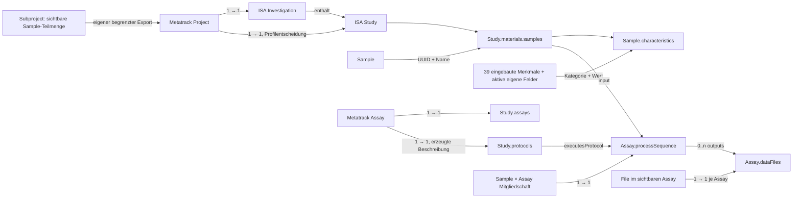
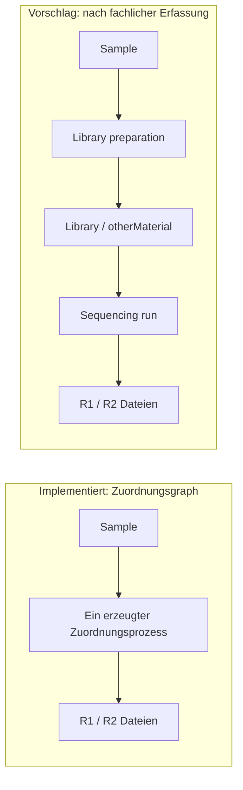

# Metatrack → ISA-JSON: Mapping zur fachlichen Prüfung

Stand: 2026-10-22. Vorschlag, noch keine Änderung des Exporters.
Codebasis: API `a389cf4`, Branch `explore/isa-json`, Profil `exploration-v1`.
Grundlage sind die Java-Entities, die API-DTOs, der tatsächliche Export-Writer und die
bereits vorhandenen synthetischen Exporte vom 19. Oktober. Keine Live-Projektdaten abgefragt.

## Vorschlag

Den vorhandenen Export als **Metadatenprofil** weiterentwickeln. Ein Projekt wird zu
einer Investigation mit zunächst genau einer Study; Samples, ihre Merkmale, Assays
und Dateizuordnungen bleiben erhalten. Dieses Profil soll auch unvollständige
Forschungsmetadaten darstellen können und seine Einschränkungen ausweisen.

Ein späteres **MARS/ENA-Profil** ergänzt fachlich bestätigte Libraries, Prozessschritte,
Repository-Metadaten und Dateiverfügbarkeit. Es braucht eine eigene Vorprüfung.
Allein aus `libraryName` oder einer Sample-Assay-Zuordnung darf keine experimentelle
Provenienz entstehen. Die beiden Profile und ihre Versionsnamen sind ein Vorschlag;
implementiert ist weiterhin nur `exploration-v1`.

Die zugehörige [Mapping-Datei](isa-json-mapping-review.json) enthält je Zuordnung:
Quellfelder, aktuellen Zielpfad, Mappingart, Grenze, Vorschlag und Review-Entscheidung.
Die interaktive Ansicht im Gespräch zeigt diese Zuordnungen und Beispiele aus dem
synthetischen Export. Sie ist eine Momentaufnahme dieses Code- und Datenstands.

## Struktur und Kardinalität

Das Diagramm zeigt Exportabbildungen; die erzeugte Study und das Protocol sind keine
zusätzlichen Metatrack-Datenbankobjekte. Das aktuelle Protocol beschreibt eine Zuordnung,
keine dokumentierte Laboranweisung. Ein Subproject wird nicht als zusätzliche Study des
Elternprojekts interpretiert. Sample-IDs bleiben in Eltern- und Teilmengenexport identisch.

## Vollständiges Inventar der Sample-DTO-Felder

Der Writer serialisiert `SampleResponse` und übernimmt alle nicht-null Felder außer
`id`, `name`, `createdOn`, `modifiedOn`, `customMetadata` als Characteristics. Dadurch
werden neue DTO-Felder derzeit automatisch exportiert. Empfehlung: explizites,
versioniertes Feldregister mit Review für neue Felder, um unbeabsichtigte Änderungen
des Austauschvertrags zu vermeiden.

| Quellfelder | Aktuelles ISA-Ziel und Werttyp | Fachliche Bewertung |
| --- | --- | --- |
| `id`, `name` | Sample `@id`, `name` | Direkte Zuordnung; UUID bleibt erhalten. |
| `taxId`, `hostTaxId` | Characteristics `tax_id`, `host_tax_id`; Zahl | IDs bleiben erhalten, aber keine standardisierten Organismus-/Host-Ontologieannotationen. |
| `collectionDate` | Characteristic `collection_date`; ISO-Datumsstring | Sammlungsdatum bleibt erhalten; keine automatisch erzeugte Probenentnahme. |
| `latitude`, `longitude` | Characteristics `latitude`, `longitude`; Zahl | Keine Einheiten/Referenzsysteme exportiert; nicht ergänzen, solange nicht festgelegt. |
| `alias`, `mlst`, `isolationSource`, `location`, `sequencingLab`, `institution`, `hostHealthState`, `projectTitle`, `description`, `isolate`, `collectedBy`, `environmentalSample`, `hostAssociated`, `hostCommonName`, `hostSubjectId`, `collectorName`, `collectingInstitution`, `hostSex`, `influenzaTestMethod`, `influenzaTestResult`, `otherPathogensTested`, `otherPathogensTestResult`, `hostHabitat`, `isolationSourceHostAssociated`, `hostBehaviour`, `isolationSourceNonHostAssociated`, `influenzaVirusType`, `influenzaSubType`, `serovar`, `strain`, `hostAge`, `county`, `commune`, `hospitalHealthInstitution` | Je eine Characteristic mit snake_case-Feldname; String | 34 Textfelder. Bezeichnungen und Werte sind noch kein kontrolliertes semantisches Mapping. Auch `hostAge`, `environmentalSample`, `hostAssociated` sind im Quellmodell Strings. |
| `customMetadata` | Je aktiver Definition eine Characteristic | TEXT → String; NUMBER → Zahl; BOOLEAN → `"true"`/`"false"`; DATE → ISO-String. |
| `createdOn`, `modifiedOn` | Nicht exportiert | Auditdaten, keine ISA submission/publicRelease dates. |

Damit sind alle 44 DTO-Felder erfasst: 2 Identitätsfelder, 39 eingebaute Merkmale,
1 Container für eigene Werte, 2 ausgeschlossene Auditfelder. Diese Zahl beschreibt
Feldabdeckung im Quellcode, nicht semantische Interoperabilität. Das Demo belegt nur
drei eingebaute Merkmale (`collectionDate`, `location`, `description`) plus vier eigene
Felder. Nicht belegte Merkmale sind damit nicht anhand realer Werte validiert.

Eigene Kategorien verwenden die Feld-UUID, nicht nur das Label. Die Kommentare
`metatrack:fieldKey`, `metatrack:fieldType`, optional `metatrack:tooltip` liegen unter
`characteristicType.comments`. Die Bedeutung dieser Kommentare ist eine lokale
Konvention. Ein allgemeiner ISA-Consumer muss sie nicht verstehen. Erlaubte Wertelisten
und archivierte Definitionen werden nicht übertragen. Ein verlustfreier Reimport des
ganzen Projekts ist deshalb weder implementiert noch durch den Export zugesichert.

## Assay- und Dateifelder

| Metatrack | Aktueller ISA-Pfad relativ zum Assay bzw. Process | Vorschlag |
| --- | --- | --- |
| `Assay.id` | `@id` und abgeleiteter `filename` | Beibehalten; `a_UUID.txt` ist ein Metadatenlabel, keine mitgelieferte ISA-Tab-Datei. |
| `Assay.name` | `comments[metatrack:assayName]`, Protocol-/Process-Name | Konvention dokumentieren. Das Assay-Schema hat kein eigenes `name`-Feld. |
| `instrumentModel` | `technologyPlatform`, Parameter `INSTRUMENT_MODEL` | Beibehalten; Plattform und Modell zusätzlich gegeneinander prüfen. |
| `sequencingPlatform` | Parameter `PLATFORM` | ENA-Vokabular prüfen; im Demo fehlt der Wert. Nicht aus dem Modellnamen erraten. |
| `sequencingLaboratory` | Parameter `SEQUENCING_LABORATORY` | Beibehalten; kein automatisches Mapping zu Person/Performer. |
| `libraryName` | Parameter `LIBRARY_NAME` | Ein Textwert identifiziert noch keine Library-Instanz. |
| `librarySource`, `librarySelection`, `libraryStrategy`, `libraryLayout` | Parameter `LIBRARY_SOURCE`, `LIBRARY_SELECTION`, `LIBRARY_STRATEGY`, `LIBRARY_LAYOUT` | Im Metadatenprofil beibehalten; im späteren Profil der richtigen Library/Prozessinstanz zuordnen. |
| `insertSize` | Parameter `NOMINAL_LENGTH`; Zahl | Bedeutung/Einheit und Eignung als nominelle Insertlänge bestätigen. |
| `studyAccession` | Kommentar `metatrack:studyAccession` | Nicht ungeprüft nach `Study.identifier` verschieben. Repository, Geltungsbereich und Adapterverwendung festlegen. |
| `Assay.samples` | `materials.samples`-Referenzen und ein Process je Sample | Assay-Metadaten werden auf alle Sample-Prozesse kopiert. Mehrere Libraries/Runs pro Sample sind nicht unterscheidbar. |
| `File.uuid`, `fileName` (DTO: `name`) | `dataFiles[].@id`, `.name` | Beibehalten. Gleiche Dateinamen verschiedener Samples brauchen beim Transfer einen kollisionsfreien Zielpfad. |
| Dateiendung | `type=Raw Data File`, Kommentar `file type=fastq` für FASTQ/FQ, auch gzip | Andere Typen bleiben unklassifiziert; Dateiendung ist keine Inhaltsprüfung. |
| `md5`, `unencryptedMd5` | Kommentare `file checksum`, `metatrack:unencryptedMd5` | Prüfsumme muss zu den tatsächlich übermittelten Bytes passen. |
| `readRole`, `status` | Kommentare `metatrack:readRole`, `metatrack:uploadStatus` | Metadatenexport darf PENDING darstellen; Submission muss verfügbare Dateien und Read-Paarung prüfen. |
| `File.sample`, `File.assay` (DTO: `sampleId`, `assayId`) | Process-Outputs bzw. enthaltendes Assay | Nur Dateien sichtbarer Assays werden geladen. Dateien ohne passende Sample-Mitgliedschaft können keinen Process-Output bekommen; Vorprüfung ergänzen. |
| `File.id`, `objectKey`, `virtualPath`, `uploadedBy`; Assay-/Project-Auditdaten und Projektmitglieder | Nicht exportiert | DB-Schlüssel/Storagepfade nicht als portable Datenadresse verwenden; Account-Mitgliedschaft ist keine wissenschaftliche Autorschaft. |

Parameterdefinitionen stehen unter `studies[].protocols[].parameters[]`, die Werte unter
`studies[].assays[].processSequence[].parameterValues[]`. Kategorien werden per `@id`
referenziert. Nicht-null, aber leere Strings werden derzeit nicht allgemein entfernt.
Dateien ohne Assay sind nicht Bestandteil dieses Exportpfads. Eine Datei im Hauptprojekt
kann im `dataFiles`-Array erscheinen, obwohl ihr Sample nicht Mitglied des Assays ist;
Referenzauflösung allein erkennt eine solche unverbundene Datei nicht.

## Die zentrale Modelllücke

Im Zielbild darf ein Sample mehrere Libraries haben und eine Library mehrere Runs.
Ein Run hat seine tatsächlich erzeugten Dateien. Extraktion, Source-Materialien und
Pooling werden nur ergänzt, wenn bekannt. Für den ersten Adapterversuch empfehle ich
eine explizit eingeschränkte Fixture mit einer Library pro Sample und einem Run pro
Library. Das ist eine Fixture-Annahme, keine Ableitung aus bestehenden Daten und keine
allgemeine 1:1-Regel. Der gepinnte Adapter löst entlang der Materialherkunft ein einzelnes
Sample auf; Pooling mehrerer biologischer Samples muss gesondert geprüft werden.

Die fachliche Library entspricht in ISA-JSON einem `materials.otherMaterials[]`-Knoten.
Im geprüften ISA-Schema sind dessen `type`-Werte auf `Extract Name` und `Labeled Extract Name`
begrenzt; `type: "Library"` wäre kein gültiger Ersatz. Die konkrete Darstellung und
`derivesFrom`-Referenzen müssen an Schema **und** Adapter-Fixture geprüft werden.

## Zusätzliche Erkenntnisse aus dem gepinnten MARS-Adapter

Diese Aussagen beziehen sich auf Commit `8cc6fca592ff1695bd795144d7816bef984712df`,
nicht auf eine Zusage über alle MARS-Versionen. MARS-spezifische Comment-Namen sind
Adapterkonventionen, keine neuen ISA-Kernfelder.

| Stelle im Adapter | Beobachtung | Konsequenz für Metatrack |
| --- | --- | --- |
| `WebinStudyXmlCreator.createStudyElement` | ENA STUDY wird je ISA-Assay erzeugt; Title/Description kommen aus ISA Study. `STUDY_TYPE` oder `existing_study_type` ist erforderlich. | Keine ungeprüfte Gleichsetzung ISA Study = ENA Study. Der Typ fehlt im Demo; existierende Study-Accessions brauchen einen eigenen Vertrag. |
| `WebinExperimentXmlCreator.mapExperimentForDataFile` | Sucht von Datei über Sequenzierungsprozess zur Library; ohne Library wird das Experiment übersprungen. | Der aktuelle Zuordnungsgraph liefert diese Library nicht. Eine leere Experimentliste muss im Integrationstest als Fehler gelten. |
| `WebinExperimentXmlCreator.createExperimentElement`, `addLibraryDescriptor`, `addPlatform` | Benötigt `DESIGN_DESCRIPTION`, Library-Strategie/-Source/-Selection/-Layout, `PLATFORM` und `INSTRUMENT_MODEL`. | Demo hat die vier Library-Werte und Instrument, aber weder `DESIGN_DESCRIPTION` noch `PLATFORM`. In Metatrack fehlt zudem ein explizites Assay-Designbeschreibungsfeld. |
| `WebinRunXmlCreator` | Ein ENA RUN je Sequenzierungsprozess, gemeinsam für dessen Output-Dateien. Benötigt `name`, `file type`, `file checksum`. | R1 und R2 zusammenhalten. Mehrere Runs/Lanes dürfen nicht allein nach Sample × Assay zusammenfallen. |

BioSamples-Accessions bzw. passende Receipts, Zielrepository-Auswahl, Organismus-Terme,
gültige Repository-Vokabulare und erreichbare Dateien sind weitere offene Arbeitspunkte.
Diese Liste ist eine Mappinganalyse, keine vollständige ENA-Checkliste.

## Entscheidungen für dieses Review

| ID | Empfehlung | Zu klären |
| --- | --- | --- |
| D1 | Ein Projekt → eine Investigation + eine Study für das erste Metadatenprofil. | Reicht diese fachliche Granularität? Subproject bleibt eine Zugriffsmenge. |
| D2 | Stabile, installationsqualifizierte IDs und ein versioniertes Feldregister. | Persistente Instanzkennung; Verhalten beim Umzug und Zusammenführen von Installationen. |
| D3 | Unbekannte Semantik als Rohwert bewahren; geprüfte Begriffe/Einheiten gezielt ergänzen. | Priorität für Organismus/Host, Sammlungsdatum, Geografie und projektspezifische Felder. `treatment_group` nur nach Bestätigung als Study Factor behandeln. |
| D4 | Library-/Run-Zuordnung explizit erfassen. | Welche Assays sind homogene Methoden, welche Batches? Können mehrere Libraries oder Runs je Sample vorkommen? |
| D5 | Separates MARS/ENA-Profil mit datenabhängiger Vorprüfung. | Zielrepository, Study-Granularität, Accessions/Receipts, Dateibereitstellung und Pflichtmetadaten. |

Nächster sinnvoller Umsetzungsschritt: D1–D3 im Metadatenprofil präzisieren und eine
kleine explizite Library/Run-Fixture für D4–D5 erstellen. Erst deren tatsächlichen
MARS-Parser und die XML-Erzeugung offline testen. Erwartete Anzahl und Inhalte von
Study/Experiment/Run prüfen, einschließlich gepaarter Reads. Eine erfolgreiche
Serialisierung oder leere, fehlerfreie Adapterausgabe reicht nicht als Nachweis.
S2S-Authentifizierung und Import folgen weiterhin separat.

## Prüfstand und Nachweise

Am 22. Oktober erneut geprüft: vorhandener Hauptprojekt- und Teilmengenexport bestehen
ISA-Draft4-Schema, MARS-JSON-Schema und interne Referenzauflösung. Der Validator legt
nur für die MARS-Prüfung den Wrapper `{"investigation": ...}` um das ISA-Dokument.
Der Download selbst hat weiterhin die Investigation als Wurzel.

| Vorhandene synthetische Fixture | Studies | Samples | Assays | Prozesse | Dateien |
| --- | ---: | ---: | ---: | ---: | ---: |
| `target/isa-demo.json` | 1 | 2 | 1 | 2 | 4 |
| `target/isa-demo-subset.json` | 1 | 1 | 1 | 1 | 2 |

Alle sechs Dateieinträge in diesen zwei Exporten sind PENDING-Platzhalter; die zwei
Teilmengendateien sind dieselben logischen Dateien wie im Hauptprojekt. Es wurden keine
Dateiinhalte übertragen. MARS-Parser/Adapter wurden für diese Review-Runde **nicht
ausgeführt**; die Adapterbefunde stammen aus Quellcodeinspektion. Kein Submission-Test.
Der Reproduktionsbefehl steht in [isa-json-exploration.md](isa-json-exploration.md).

Lokale Evidenz:

- [Writer](../src/main/java/no/metatrack/server/isa/IsaJsonExportWriter.java)
- [Scope und Datenbeschaffung](../src/main/java/no/metatrack/server/isa/IsaJsonExportService.java)
- [SampleResponse](../src/main/java/no/metatrack/server/sample/SampleResponse.java)
- [Assay](../src/main/java/no/metatrack/server/assay/Assay.java), [File](../src/main/java/no/metatrack/server/file/File.java)
- [Demo-Erzeugung](../scripts/seed-isa-demo.py)

Externe Primärquellen:

- [ISA-Modell](https://isa-specs.readthedocs.io/en/latest/isamodel.html) und [ISA-JSON](https://isa-specs.readthedocs.io/en/latest/isajson.html), am 22. Oktober geprüft.
- [Gepinnte ISA-Schemata](https://github.com/ISA-tools/isa-specs/tree/ed80675acb5ff98249e9821067eff83740d809d6/source/_static/isajson).
- [Gepinnter MARS ENA-Adapter](https://github.com/elixir-europe/MARS/tree/8cc6fca592ff1695bd795144d7816bef984712df/repository-services/isajson-ena/src/main/java/com/elixir/biohackaton/ISAToSRA/sra/service), insbesondere die drei oben genannten Creator-Klassen.
- [Gepinntes MARS-Schema](https://github.com/elixir-europe/MARS/blob/8cc6fca592ff1695bd795144d7816bef984712df/schemas/isa_json.schema.json).
